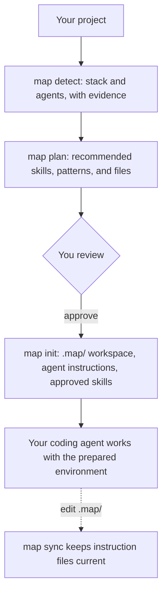

<p align="center">
  
</p>

<h1 align="center">MAP — AI Development Environment Manager</h1>

<p align="center">
  Prepare, configure, and maintain AI coding environments across projects and agents.
</p>

<p align="center">
  <a href="https://github.com/rajanbor/map/actions/workflows/ci.yml"></a>
  <a href="library/LICENSE"></a>
  <a href="library/LICENSE-CONTENT"></a>
  
</p>

## What is MAP?

MAP is a command-line tool that looks at a software project, works out its stack and
which AI coding agents it uses, and sets up a consistent environment for those
agents: instruction files, Agent Skills, and engineering patterns. It is for
developers and teams who use Claude Code, Codex, Cursor, GitHub Copilot, or Gemini CLI
across several projects. MAP does not write your application code — your coding agent
does. MAP prepares and maintains the configuration around it.

## Why MAP?

- **Setup repeats.** Every new project needs the same agent instructions, skills, and
  conventions copied in by hand.
- **Instructions scatter.** `CLAUDE.md`, `AGENTS.md`, Cursor rules, and Copilot
  instructions drift apart. MAP keeps one source in `.map/` and generates the rest.
- **Skills are hard to manage.** Finding a skill, checking what it does, installing it
  for each agent, and updating it is manual. MAP does it with a lockfile and an audit.
- **Environments are hard to reproduce.** MAP pins skills to exact commits, so a
  teammate gets the same files.
- **Architecture standards get skipped.** MAP recommends patterns such as
  prompt-injection defense when it sees evidence that you need them.

## Quick start

Requirements: Git, Node.js 20+, and `pnpm` or `corepack`. MAP installs from this
repository (the 0.5.1 release on npm predates the features below).

```bash
git clone https://github.com/rajanbor/map.git
cd map && ./scripts/install.sh
```

Then, in your project:

```bash
cd my-project
map plan      # see what MAP would do — writes nothing
map init      # review, confirm, apply
```

## How it works



1. MAP reads marker files and dependency manifests as data. It never runs your code.
2. It recommends skills from configured sources and patterns from its catalog, and
   says why, pointing at the file that triggered each recommendation.
3. You choose. Nothing is installed without your selection, and skills that bundle
   scripts need explicit approval.
4. MAP writes `.map/`, generates each agent's instruction file, installs the chosen
   skills into each agent's skills directory, and records them in a lockfile.

## Features

- **Project detection** — TypeScript, JavaScript, Python, Rust, Go, Java, PHP;
  Next.js, React, Vue, Angular, Express, NestJS, FastAPI, Django, WordPress, Tailwind
  CSS; Docker, Compose, GitHub Actions, PostgreSQL, Redis, Prisma, Drizzle; Vitest,
  Jest, pytest, Cargo, ESLint, Prettier, Ruff; nested workspaces in monorepos. Every
  signal is `confirmed` or `probable` and cites a file.
- **Agent Skills** — list, search, inspect, recommend, install, update, remove, and
  audit skills in the standard `SKILL.md` format, from any Git repository or local
  folder. Default source: [`rajanbor/skills`](https://github.com/rajanbor/skills).
- **Reproducible installs** — `.map/skills.lock.json` pins each skill to a commit SHA
  and a content digest; `map skills install` restores exactly that.
- **Security checks** — skills are read from Git without a checkout; symlinks, unsafe
  paths, and oversized files are rejected; scripts and risky content need approval;
  user files are never overwritten. See [the security model](docs/skills.md#security-model).
- **Development profiles** — `webapp`, `api`, `wordpress`, `python`, `rust`, `ai-app`,
  `security-first`, combinable.
- **Planner** — `map plan` shows detected facts, selected agents, recommendations,
  file changes, conflicts, and decisions you need to make; `--json` for automation.
- **Instruction generation** — one `.map/` source compiled into each agent's native
  file. Generated files carry a hash, so MAP detects hand edits and never replaces a
  file it did not write.
- **Pattern library** — 96 AI engineering patterns (5 published with prompts and
  acceptance criteria) with trade-offs, failure modes, and relationships.
- **Health checks** — `map doctor`, `map sync --check`, and `map skills audit` for CI.

## Supported agents

| Agent | Detection | Instruction file | Skill installation |
|---|---|---|---|
| Claude Code | yes | `CLAUDE.md` | `.claude/skills` |
| OpenAI Codex | yes (`AGENTS.md` is probable) | `AGENTS.md` | `.agents/skills` |
| Cursor | yes | `.cursor/rules/map.mdc` | `.cursor/skills`, or shared `.claude/skills` |
| GitHub Copilot | yes | `.github/copilot-instructions.md` | `.github/skills`, or shared `.claude/skills` |
| Gemini CLI | yes | `GEMINI.md` | `.gemini/skills` (Gemini marks skills experimental) |

MAP does not manage agent settings such as permissions, hooks, MCP servers, or models.
Details and sources: [docs/agents.md](docs/agents.md).

## CLI reference

| Command | What it does |
|---|---|
| `map detect [path]` | Show the detected stack and agents with evidence. |
| `map plan [path]` | Show what `init` would set up. Writes nothing. |
| `map init` | Plan, confirm, and apply. `--yes` for safe non-interactive defaults. |
| `map profiles` | List development profiles. |
| `map skills list \| search \| info` | Browse skills from configured sources. |
| `map skills suggest` | Recommend skills for this project, with evidence. |
| `map skills add <name...>` | Audit and install skills; update the lockfile. |
| `map skills install` | Reinstall the exact locked revisions. |
| `map skills update \| remove \| audit` | Maintain installed skills. |
| `map sync [--check]` | Regenerate agent instruction files from `.map/`. |
| `map scan` / `map suggest` | Detect AI architecture concepts and suggest patterns. |
| `map list` / `map search` / `map show <id>` | Browse the pattern catalog. |
| `map add <pattern-id>` | Copy a published pattern's prompt and acceptance criteria into `.map/`. |
| `map doctor` | Check workspace, compiler, registry, and installed skills. |
| `map optimize` | Measure the context size of `.map/` against a budget. |

Common flags: `--json` (versioned output on stdout), `--agents claude,codex`,
`--profile webapp,security-first`, `--dry-run`, `--no-skills` (offline). Exit code 0
means success; 1 means an error, a conflict, a missing approval, or a failed check.
`analyze`, `recommend`, `patterns`, and `explain` remain as older names.

## Use cases

The outputs below were produced by running MAP on small sample projects.

### 1. A Next.js application with Claude Code

```bash
cd shop            # package.json with next, react, tailwindcss; CLAUDE.md you wrote
map plan
```

MAP detects TypeScript, Next.js, React, and Tailwind CSS from `package.json`, and
Claude Code from `CLAUDE.md`. It recommends `design-guardrails` (evidence: `next`,
`react`, `tailwindcss` in `package.json`), notes that the skill bundles one script, and
reports that no configured skill covers pull-request review even though GitHub Actions
are present. It also reports that your `CLAUDE.md` was not written by MAP and will be
kept.

```bash
map init --yes --profile webapp --skills design-guardrails --allow-scripts
```

This creates `.map/` with a `profiles/webapp.md` conventions file, installs the skill
into `.claude/skills/design-guardrails`, pins it in `.map/skills.lock.json`, and leaves
your `CLAUDE.md` untouched. To let MAP generate `CLAUDE.md`, move your notes into a
file under `.map/` and run `map sync --force` (a backup is kept).

### 2. A Python project

```bash
map plan --agents claude     # pyproject.toml with fastapi, pytest, [tool.ruff]
```

MAP recommends `python-project` because `pyproject.toml` exists, and lists the
scripts it bundles (`scripts/scaffold.sh`). Installing it with
`map skills add python-project --allow-scripts` copies the skill into
`.claude/skills/`. That is all MAP does: it does not run the scaffold script, add
Ruff or mypy to your project, or change `pyproject.toml`. When you ask Claude Code to
set up linting or tests, Claude reads the skill and follows its workflow. MAP also
reports that FastAPI suggests an API security review, for which no skill is
configured.

### 3. An existing WordPress site

```bash
map detect
```

MAP confirms WordPress from `wp-config.php`, the `wp-content/` directory, and a theme
`style.css` header, and marks PHP as only *probable* when there is no
`composer.json`. It recommends `wordpress-security-audit` and
`wordpress-tailwind-theme`. Limits: detection stops three directories deep, does not
read plugin code, and cannot tell which WordPress version or plugins are running in
production — the audit skill asks for that, and should only be used on sites you are
authorized to test.

### 4. Security-first development

```bash
map plan --profile api,security-first     # Express API with a Dockerfile
```

The profiles add conventions (never commit secrets, explain security impact of
changes, ask before changing systems outside the repository) and the
`security/prompt-injection-defense` and `security/least-privilege-tool-access`
patterns. MAP reports that the default source has no API-security or container
hardening skill rather than inventing one; add a source that has them. Skills and
instructions guide the agent but enforce nothing: run secret scanning, dependency
audits, and `map skills audit` in CI or Git hooks if they must always happen.

### 5. A team using Claude Code and Codex

```bash
map init --yes --agents claude,codex --skills design-guardrails --allow-scripts
```

Both agents get the same project knowledge: everything in `.map/` compiles into
`CLAUDE.md` and `AGENTS.md`. The skill is installed into both `.claude/skills/` and
`.agents/skills/` because the two agents read different directories (Cursor and
Copilot can share `.claude/skills`, so MAP writes one copy for them). What stays
agent-specific: file formats, skill directories, and agent settings MAP does not
manage. If the team already has a hand-written `AGENTS.md`, MAP keeps it and reports
a conflict instead of overwriting it.

### 6. An AI application

```bash
map plan --profile ai-app        # requirements.txt with openai, chromadb, langchain
```

The AI-architecture scan finds LLM usage, vector search, and RAG in the dependency
list and recommends patterns: prompt-injection defense (high priority, because
retrieved text flows into prompts), groundedness evaluation, a golden dataset, LLM
as judge, a semantic cache, and tracing. Patterns are architecture guidance with
trade-offs and acceptance criteria (`map show <id>`, `map add <id>` for published
ones); skills are agent instructions. MAP keeps the two separate.

## Project structure

| Path | Contents |
|---|---|
| [`tooling/`](tooling/) | The TypeScript CLI (`packages/cli`) plus the registry and score packages. |
| [`library/`](library/) | Pattern library, JSON Schemas and their guides, examples, reference implementations. |
| [`docs/`](docs/) | User and architecture documentation. |
| [`apps/website/`](apps/website/) | Static pattern browser built from the registry. |
| [`.map/`](.map/) | MAP's own workspace; `CLAUDE.md`, `AGENTS.md`, and `GEMINI.md` are generated from it. |
| [`scripts/`](scripts/) | The installer. |

A project set up by MAP gets `.map/` (configuration, notes, decisions, profiles,
lockfile), generated instruction files, and skill directories such as
`.claude/skills/`.

## Development

```bash
cd tooling
corepack pnpm install --frozen-lockfile
corepack pnpm lint && corepack pnpm typecheck && corepack pnpm test && corepack pnpm build
node packages/cli/bin/map.ts --help      # run the CLI from source
```

Tests run offline. Edit `.map/` rather than the generated `CLAUDE.md`/`AGENTS.md`, and
run `map sync` afterwards. See the [contribution guide](library/CONTRIBUTING.md).

## Limitations and roadmap

Detection is static and three levels deep; the skill audit is heuristic; skills
install per project only; the default skill source is small and partly in Polish;
pattern-to-skill links exist only through profiles. Full list and plans:
[docs/roadmap.md](docs/roadmap.md).

## License

Code (`tooling/`, `scripts/`, reference implementations, examples) is
[MIT](library/LICENSE). Patterns and documentation are
[CC BY 4.0](library/LICENSE-CONTENT). The MAP name and logo are not licensed; see
[LICENSING.md](library/LICENSING.md). Skills installed from external sources keep
their own licenses.
